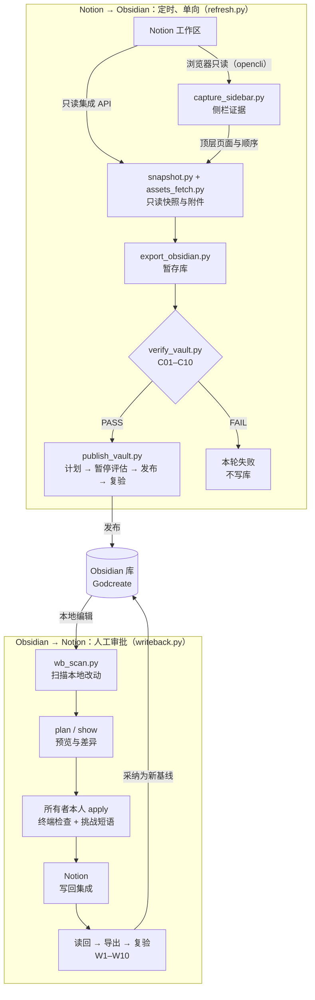

# AI_Notion_Obsidian

AI_Notion_Obsidian AI notion 自动同步 obsidian 与 obsidian 协调同步 notion


[](LICENSE)

一套运行在 Linux 上的 Python 工具：把 Notion 工作区按原有层级、顺序和附件**定时单向导出**到 Obsidian 库；Obsidian 中的修改则先生成预览，**只有工作区所有者本人在自己的终端确认后**才写回 Notion，写入后立即读回并校验。

> 文档入口：[文档索引](docs/README.md) · [部署指南](docs/deployment/deployment-guide.md) · [操作手册](docs/usage/operations-manual.md) · [运维指南](docs/operations/operations-guide.md) · [故障排查](docs/troubleshooting/troubleshooting.md) · [开发者指南](docs/development/developer-guide.md)

## 目录

- [项目简介与建设背景](#intro)
- [主要功能](#features)
- [使用场景](#scenarios)
- [架构与数据流](#architecture)
- [技术栈及版本要求](#stack)
- [项目目录结构](#layout)
- [环境依赖与部署步骤](#deploy)
- [配置文件说明及环境变量示例](#config)
- [本地运行、构建和验证方法](#run)
- [常见问题及注意事项](#faq)
- [安全说明](#security)
- [文档索引](#docs)
- [移植性说明](#portability)
- [许可证](#license)
- [致谢与作者](#credits)

<a id="intro"></a>
## 项目简介与建设背景

项目所有者的知识库同时存在于 Notion 工作区 **Godcreate**（五个团队协作区：General、Quantitative Investing、x_to_notion、Godcreate Business、Godcreate AI工作空间）和 Obsidian 库中。Obsidian 库通过 Obsidian Sync 在多台设备间同步。目标是让 Notion 中的内容自动、完整地出现在 Obsidian 中，同时允许在 Obsidian 里做的修改**有控制地**回到 Notion，并保证不覆盖、不误改、不误删任何一侧的内容。

2026-11-17 完成首次全量迁移与每日增量同步部署；随后在开发沙箱中实现了经人工审批的写回功能，配套编写了导出契约 [SPEC v1.3](docs/design/SPEC.md)、写回规格 [WRITEBACK_SPEC v1.1](docs/design/WRITEBACK_SPEC.md) 和[设计稿](docs/design/BIDIRECTIONAL_DESIGN.md)。2026-11-21 部署到生产环境，并在一个测试页上完成了首次由所有者本人审批的真实写回（W1–W10 检查通过或有理由的不适用）。当前生产配置为只预览的 `plan` 模式，后续扩大写回范围须逐步授权（见[操作手册 §7.3](docs/usage/operations-manual.md#sec-7-3)）。

设计原则：**凡是不能证明安全的操作，一律不执行，只报告。** 自动管线对 Notion 只读；所有写入都必须经过预览、本人确认和写后核对。

<a id="features"></a>
## 主要功能

**Notion → Obsidian（自动、单向）**

- systemd 用户定时器：每天 00:30 / 06:30 / 12:30 / 18:30 增量刷新，每周日 05:30 全量重读。
- 通过浏览器只读采集 Notion 侧栏，按团队协作区和顶层页面的真实顺序建立目录；custom-sort 插件按 Notion 顺序显示文件。
- 只读快照（SQLite）+ 附件按 sha256 落盘；页面、目录笔记、数据库（含 `.base` 视图）、模板、内部链接、附件都转换为 Obsidian 格式。
- 导出到暂存库后由独立校验器检查 C01–C10（结构、身份、层级、顺序、排序配置、链接、附件、frontmatter、文件名、正文完整性），全部通过才发布；C11 敏感串只警告。
- 两阶段发布：先生成计划并评估暂停规则（源端大量改动或消失、冲突过多、本地大批删除、渲染器变化等），再按计划写入，每次替换前备份，发布后复验；可按日志撤销一次发布。
- 本地修改保护：本地改过的笔记不会被覆盖，两侧都改时把 Notion 版本另存到 `Notion_Obsidian/conflicts/`；工具从不删除库内文件。
- 库内运行记录（`Notion_Obsidian/运行记录/`）提示暂停、失败、未共享的新顶层页、侧栏采集失败与额度警告。

**Obsidian → Notion（手动、审批）**

- 模式逐级开放：`off` → `plan`（只预览）→ `whitelist`（只写白名单页面）→ `full`；工具只会自动降级，从不自动升级。
- `writeback.py plan` 生成带统一差异的预览，按 M（修改）/ N（新建）/ T（改名）/ D（删页）/ B（删块）/ MV（移动）/ C（冲突）分类，逐项列出拒绝原因。
- `apply` 只能由所有者本人在交互终端执行：终端检查 + 现场挑战短语 + 计划 SHA 与选择项绑定。
- 写入后定向读回、导出、复验并采纳为新基线，输出 W1–W10 写后检查；支持急停、续办、按项回退、未知结果人工核对。
- 安全阈值与熔断：单页操作数、修改笔记数、本地删除数、Sync 稳定期、批量变化、请求限速、Notion 免费额度预警等。

<a id="scenarios"></a>
## 使用场景

- 以 Notion 为主要编辑环境，希望在 Obsidian 中离线阅读、检索、做双链和图谱，并在多设备间同步。
- 需要一份可审计的 Notion 内容本地副本（快照、附件、发布日志和备份都在本机）。
- 偶尔在 Obsidian 中修订段落、待办或标题，希望在确认差异后安全地回写到 Notion，而不是手工复制粘贴。
- 需要在 AI 助手协助维护的环境中运行：AI 可以查看状态和预览，所有改变 Notion 的操作都留给本人确认。

<a id="architecture"></a>
## 架构与数据流



两个方向共用 `state/refresh.lock`（不排队，遇锁即跳过或拒绝）和跨进程限速 `state/rate_gate.json`（合计 2.5 次/秒）。读令牌与写令牌严格分开：自动管线只用只读客户端，写客户端只在本人确认后的执行器中出现。

<a id="stack"></a>
## 技术栈及版本要求

| 组件 | 要求 | 实测版本 / 说明 |
|---|---|---|
| 操作系统 | Linux + systemd 用户实例 | Ubuntu 24.04.5 LTS，systemd 255 |
| Python | 3.12 | 3.12.3（纯 Python，无需编译） |
| requests | ≥ 2.31 | 2.31.0 |
| PyYAML | ≥ 6.0 | 6.0.1 |
| markdown-it-py | ≥ 3.0 | 3.0.0 |
| pexpect（仅测试） | ≥ 4.9 | 4.9 |
| SQLite（Python 内置） | ≥ 3.35 | 3.45.1 |
| Notion API | `Notion-Version: 2026-03-11` | 读写客户端固定此版本 |
| Obsidian | 桌面版（写回要求本机桌面端运行满 15 分钟） | 1.15.1；可选 Obsidian Sync |
| custom-sort 插件 | 3.2.0 | 按 Notion 顺序显示文件 |
| 侧栏采集 | Chrome + `opencli` 浏览器桥接 | `@jackwener/opencli` 1.8.6（源码构建），Node.js v24；安装方法见[部署指南 §8](docs/deployment/deployment-guide.md#dep-8)，以上游文档为准 |

<a id="layout"></a>
## 项目目录结构

```text
AI_Notion_Obsidian/
├── README.md
├── requirements.txt                  # requests、PyYAML、markdown-it-py；测试用 pexpect
├── .gitignore                        # 排除 *.env、*.db、运行时目录与缓存
├── docs/                             # 全部文档（见“文档索引”）
│   ├── README.md
│   ├── usage/ deployment/ operations/ troubleshooting/ development/
│   ├── design/                       # SPEC、WRITEBACK_SPEC、BIDIRECTIONAL_DESIGN
│   └── reference/                    # Obsidian Bases、custom-sort 核实记录
├── examples/                         # 令牌文件、写回配置、根清单、长期授权的示例（占位符）
├── notion-migration/
│   └── nmig/                         # 内置的 Notion REST 工具包：client、config、rest_inventory
└── notion-obsidian/
    ├── deploy/                       # notion-obsidian-refresh@.service、-incremental.timer、-full.timer
    └── tools/                        # 28 个模块
        ├── refresh.py                # 入口：一轮 Notion → Obsidian 刷新
        ├── writeback.py              # 入口：Obsidian → Notion 写回 CLI
        ├── capture_sidebar.py  snapshot.py  assets_fetch.py  export_obsidian.py
        ├── verify_vault.py  publish_vault.py  rollback.py  rehearse.py  trash_archive.py
        ├── wb_*.py  md2blocks.py     # 写回：扫描、计划、执行、重抓、门禁、状态、配置、锁
        ├── readonly_client.py  writeback_client.py  notion_tokens.py  rate_gate.py
        ├── sortspec.py  plugin_bundle.py
        └── tests/                    # unittest 套件、fake_notion.py、两个手动回归脚本
```

运行时，WORK（`tools/` 的上级目录）下还会出现 `config/ state/ snapshots/ staging/ reports/ logs/ backup/ blobs/ approvals/ evidence/ plugins/ rehearsal/ rollback/` 等目录，它们都已列入 `.gitignore`，不进入版本库（其中 `evidence/`、`rehearsal/`、`rollback/` 会含真实页面标题、ID 或库内容，提交前请用 `git status` 确认没有误加）。各模块说明见[开发者指南 §1](docs/development/developer-guide.md#dev-layout)。

<a id="deploy"></a>
## 环境依赖与部署步骤

完整步骤见 **[部署指南](docs/deployment/deployment-guide.md)**。概要：

1. 准备 Ubuntu 24.04、Python 3.12 与依赖：`sudo apt install python3-requests python3-yaml python3-markdown-it python3-pexpect git jq util-linux`（systemd 用 `/usr/bin/python3 -I` 启动，依赖需装在系统 Python 中；也可用虚拟环境并修改 service 的解释器）。
2. 克隆仓库，把 `notion-obsidian/tools/*.py`、`notion-obsidian/deploy/` 和 `notion-migration/nmig/` 复制到写死的路径 `/data120/Obsidian/notion-obsidian/` 与 `/data120/Obsidian/notion-migration/`（见[移植性说明](#portability)）。
3. 在 Notion 创建只读集成并共享各顶层页面；需要写回时另建只共享测试页的最小权限写回集成。
4. 按 `examples/` 创建令牌文件（600，目录 700）、`config/writeback.json`（默认 `off`）和 `approvals/standing_daily_refresh.approval.md`。
5. 在 Obsidian 中打开 `/data120/Obsidian/Godcreate`，安装 custom-sort 3.2.0；配置 opencli 侧栏采集并试采一次。**侧栏采集至少成功一次之前，定时刷新会以 `no usable sidebar evidence` 失败**（首轮可按[部署指南 §9.2](docs/deployment/deployment-guide.md#dep-9) 用根清单离线完成，但定时轮次仍需要采集）。
6. `python3 -I -B tools/refresh.py --mode full --dry-run` 预演，确认 C01–C10 全部 PASS 后正式运行一轮。
7. 复制 systemd 单元到 `~/.config/systemd/user/`，`daemon-reload`，`enable --now` 两个 timer，`loginctl enable-linger`。

<a id="config"></a>
## 配置文件说明及环境变量示例

| 文件 / 变量 | 位置 | 说明 |
|---|---|---|
| `NOTION_TARGET_TOKEN` | `~/.config/notion-migrate/.env`（600）或同名环境变量 | 读连接令牌（必需）；环境变量优先 |
| `NOTION_VERSION` | 同上，可选 | 默认 `2026-03-11`，只影响 snapshot / assets_fetch |
| `NOTION_MIGRATE_ENV_FILE` | 环境变量，可选 | 只改变 nmig 读取的文件位置；refresh / writeback 仍读默认路径，建议不用 |
| `NOTION_WRITEBACK_TOKEN` | `~/.config/notion-obsidian/writeback.env`（文件 600、目录 700，属主为当前用户） | 写回连接令牌，只有 `apply` / `rollback` / `audit-scope` 加载；不读环境变量。`writeback.py` 另有 `--token-file`（写回令牌文件，同样须 600 且目录 700）与 `--read-token-file`（读令牌文件）参数，开发者指南把它们列为演练用参数；`refresh.py` 没有对应参数，定时运行始终使用默认路径 |
| `config/writeback.json` | WORK 下 | 写回模式、白名单、阈值、限速等 26 个键；未知键会报错。[键说明](docs/deployment/deployment-guide.md#writeback-config) |
| `approvals/standing_daily_refresh.approval.md` | WORK 下 | 定时发布的长期授权记录；缺失时刷新在发布前失败 |
| `config/roots_sidebar.json` | WORK 下，可选 | 初始根清单，仅用于侧栏采集不可用时手工完成首轮快照；`refresh.py` 不读取 |
| systemd 单元 | `~/.config/systemd/user/` | 来自 `notion-obsidian/deploy/` |

令牌文件示例（[`examples/notion-migrate.env.example`](examples/notion-migrate.env.example)、[`examples/writeback.env.example`](examples/writeback.env.example)）：

```dotenv
# ~/.config/notion-migrate/.env
NOTION_TARGET_TOKEN=<your-read-only-integration-token>
# NOTION_VERSION=2026-03-11

# ~/.config/notion-obsidian/writeback.env
NOTION_WRITEBACK_TOKEN=<your-write-back-integration-token>
```

写回配置示例节选（完整文件见 [`examples/writeback.example.json`](examples/writeback.example.json)）：

```json
{
  "mode": "off",
  "whitelist_page_ids": [],
  "whitelist_scope": {},
  "test_page_id": null,
  "plan_ttl_hours": 24,
  "max_local_deletes": 5,
  "sync_settle_minutes": 15,
  "rate_limit_total_rps": 2.5,
  "read_integration_readonly_confirmed_at": null
}
```

另有 [`examples/roots_sidebar.example.json`](examples/roots_sidebar.example.json)（根清单格式）和 [`examples/standing_daily_refresh.approval.example.md`](examples/standing_daily_refresh.approval.example.md)（长期授权模板）。

<a id="run"></a>
## 本地运行、构建和验证方法

本项目是纯 Python，**没有构建步骤**。所有命令都用 `python3 -I -B` 运行（`-I` 忽略 `PYTHONPATH` 等 `PYTHON*` 环境变量和用户级 site-packages，也不把脚本目录加入 `sys.path`；`NOTION_TARGET_TOKEN` 等普通环境变量仍然生效。`-B` 不写字节码缓存）。

**1. 查看命令帮助（不访问 Notion）**

```bash
cd notion-obsidian
python3 -I -B tools/refresh.py --help
python3 -I -B tools/writeback.py --help
```

**2. 单元测试全套**（在仓库根目录执行）

```bash
# 一次性：nmig 的导入路径写死为 /data120/Obsidian/notion-migration（见开发者指南 §2，另有免 sudo 的虚拟环境方案；该路径下已有 nmig 时跳过，不要覆盖）
sudo install -d -o "$USER" -g "$USER" /data120/Obsidian/notion-migration
ln -s "$PWD/notion-migration/nmig" /data120/Obsidian/notion-migration/nmig

mkdir -p notion-obsidian/state notion-obsidian/config                     # 测试夹具（已被 .gitignore 排除）
cp examples/writeback.example.json notion-obsidian/config/writeback.json

PY=/usr/bin/python3        # 依赖装在虚拟环境时改为其解释器，如 PY=~/.venvs/notion-obsidian/bin/python3
T=$(mktemp -d) && mkdir -p "$T/home" "$T/tmp"
env -i PATH=/usr/bin:/bin HOME="$T/home" TMPDIR="$T/tmp" LANG=C.UTF-8 \
  "$PY" -I -B -m unittest discover -s notion-obsidian/tools/tests -p 'test_*.py'
```

`env -i PATH=/usr/bin:/bin` 下的 `python3` 总是解析为系统解释器 `/usr/bin/python3`，即使已激活虚拟环境也一样，所以要用 `PY` 指定装有依赖的解释器。测试只使用本机的 `fake_notion.py` 假服务和临时目录，不访问真实 Notion。2026-11-21 实测共 1088 项、约 21 分钟；准备好夹具后预期为 1 个错误（该测试读取未收入仓库的内部实现约定文档 `IMPL_CONTRACT.md`）和 8 个跳过（5 项文档一致性测试找不到沙箱路径下的 README-DEV.txt / 规格文档，3 项依赖开发沙箱数据）。用 `requirements.txt` 在虚拟环境中安装的较新版本（markdown-it-py 4.3.0、requests 2.34.2、PyYAML 6.0.4）结果相同。详见[开发者指南 §4.1](docs/development/developer-guide.md#dev-tests)。

**3. 端到端测试**（fake_notion + 伪终端审批，需要 pexpect；沿用上一步的 `PY` 与 `T`）

```bash
env -i PATH=/usr/bin:/bin HOME="$T/home" TMPDIR="$T/tmp" LANG=C.UTF-8 \
  "$PY" -I -B -m unittest discover -s notion-obsidian/tools/tests -p 'test_e2e_*.py' -v
```

2026-11-21 实测 22 项、约 4 分钟，全部通过。

**4. 在已部署的环境中验证**（在 WORK `/data120/Obsidian/notion-obsidian` 中）

```bash
python3 -I -B tools/refresh.py --mode incremental --dry-run      # 预演到发布前，不写库（仍写快照、暂存与报告）
python3 -I -B tools/writeback.py status                          # 只读：模式、计划、待确认改动、暂停对象
python3 -I -B tools/verify_vault.py --snapshot snapshots/snap_<TS>.db --sidebar <本轮使用的侧栏证据> \
  --vault staging/<RUN>/vault --out /tmp/verify-<RUN> \
  --roots-kinds snapshots/snap_<TS>.db.roots.json --snapshot-immutable \
  --expected-deviations reports/<RUN>/expected_deviations.json
```

以上参数与刷新时使用的一致（`refresh.py` 的 `verify_args`）；省略 `--expected-deviations` 时，已登记的本地偏差（本地新建、对象暂停、改名覆盖、Sync 冲突副本等）可能被判为 FAIL，与刷新记录的结论不一致。本轮实际使用的侧栏证据见 `reports/<RUN>/refresh_status.json` 的 `sidebar`（有 `sidebar_effective` 时以它为准）。`verify_vault.py` 的 `--out` 必须在库外；结果写入 `<out>/verify.json`，`status_by_check` 中 C01–C10 应为 `PASS`。

<a id="faq"></a>
## 常见问题及注意事项

| 问题 | 说明 |
|---|---|
| 历史里出现 `skipped_lock_busy` | 另一轮刷新或写回正在运行，本次直接跳过，不是故障。[详见](docs/troubleshooting/troubleshooting.md#tr-refresh) |
| 写回计划可执行数为 0、提示 `SYNC_SETTLING` | 本机 Obsidian 桌面端需运行满 15 分钟且 Sync 完成，然后重新生成计划。[详见](docs/troubleshooting/troubleshooting.md#tr-writeback) |
| 首次计划出现大量 `INITIAL_BACKLOG` | 启用前已有的差异，属正常；不要批量认可。[详见](docs/usage/operations-manual.md#sec-2) |
| 库里出现 `(Notion 版本 …)` 冲突副本 | 两边都改了同一笔记，原笔记保留，需自行合并。[详见](docs/usage/operations-manual.md#sec-5-1) |
| 一轮结果为 `paused_for_review` | 触发了整轮暂停规则，阅读库内 `-已暂停.md` 后由本人放行或放弃。[详见](docs/operations/operations-guide.md#ops-paused) |
| `sidebar_fresh=false` 或 `no usable sidebar evidence` | 侧栏采集失败；新部署必须先让 opencli 采集成功一次。[详见](docs/troubleshooting/troubleshooting.md#tr-sidebar) |
| 修改 `config/writeback.json` 后每轮刷新都失败 | JSON 损坏或出现未知键；用备份恢复并用 `json.tool` 和 `writeback.py status` 检查。[详见](docs/usage/operations-manual.md#sec-4-2) |
| 令牌权限报错或 `token workspace mismatch` | 写回令牌须 600 / 目录 700；读令牌必须属于原工作区。[详见](docs/troubleshooting/troubleshooting.md#tr-env) |

注意事项：

- 不要手动删除生产快照、暂存库、锁文件、待决计划或备份；快照每份约 436 MiB，程序自动保留最新 4 份。
- 手工查看 SQLite 一律使用 `mode=ro`；不要手工迁移 `export.db`。升级时 `tools/` 与 `state/export.db` 必须一起部署、一起回退（[Runbook](docs/development/developer-guide.md#dev-runbook)）。
- 部署、回退或本地还原前要宣布编辑冻结，所有设备暂停编辑并退出 Obsidian。
- 生产工具即使改了 `--vault` 也会写自己的状态；演练请用独立完整的工作副本。

<a id="security"></a>
## 安全说明

- **仓库中没有任何真实令牌、密码或密钥。** 测试代码中的 `ntn_…` 字符串和私钥开头行（`notion-obsidian/tools/tests/test_clients.py`、`test_verify_vault.py`）都是假数据，不对应任何凭据。真实令牌只放在用户目录的令牌文件中（读令牌也可用环境变量 `NOTION_TARGET_TOKEN` 提供）；`.gitignore` 排除了 `*.env`、`.env*`、`*.db` 和 WORK 下的全部运行时目录（`config/ state/ snapshots/ staging/ reports/ logs/ backup/ blobs/ approvals/ evidence/ plugins/ rehearsal/ rollback/`）；`examples/` 只含 `<your-...-token>` 形式的占位符。校验器的 C11 会对库内类似 `ntn_` / `secret_` 的长串发出警告。
- **读写分离。** 自动管线只通过 `ReadOnlyClient` 访问 Notion，发送前拦截 GET / search / query 以外的任何请求；写回令牌只在 `apply`、`rollback`、`audit-scope` 中加载，且要求文件 600、目录 700、属主为当前用户。
- **本人审批门禁。** 写入、续办、回退以及各种 y/N 决定都要求交互终端；`apply` 还需原样输入程序现场生成的挑战短语。检测到管道、非交互或 AI / CI 环境标记时拒绝执行。
- **AI 边界。** AI 助手只能运行 `status`、`plan`、`show`、`whitelist-check` 等只读命令；不得运行 `apply`、`rollback`、`tools/rollback.py --apply`，不得获取、转述或代输挑战短语与令牌，也不得用其他 Notion 连接或脚本绕开审批。
- **急停与撤权。** `touch state/WRITEBACK_STOP` 立即阻止后续写回；也可在 Notion 中移除写回集成的页面访问或撤销该集成。
- 文档与代码中出现的 Notion 页面 / 工作区 ID 只是对象标识，访问仍需要对应集成的令牌。发现安全问题时，请使用仓库 Security 标签页中的 “Report a vulnerability” 私密报告（需所有者在仓库的 Settings → Code security 中启用 Private vulnerability reporting 后才会出现）；**不要在公开 Issue 中粘贴任何令牌、页面 ID 以外的笔记内容或日志全文**。

<a id="docs"></a>
## 文档索引

| 分类 | 文档 |
|---|---|
| 索引 | [docs/README.md](docs/README.md) |
| 使用 | [操作手册（用户侧）](docs/usage/operations-manual.md) |
| 部署 | [部署指南](docs/deployment/deployment-guide.md) |
| 运维 | [运维指南](docs/operations/operations-guide.md) |
| 排障 | [故障排查](docs/troubleshooting/troubleshooting.md) |
| 开发 | [开发者指南（含部署 / 回退 Runbook）](docs/development/developer-guide.md) |
| 设计 | [导出契约 SPEC v1.3](docs/design/SPEC.md) · [写回规格 WRITEBACK_SPEC v1.1](docs/design/WRITEBACK_SPEC.md) · [双向同步设计稿 v0.1](docs/design/BIDIRECTIONAL_DESIGN.md) |
| 参考 | [Obsidian Bases 语法核实](docs/reference/obsidian-bases.md) · [custom-sort 插件核实](docs/reference/obsidian-custom-sort.md) |
| 示例 | [examples/](examples/) |

<a id="portability"></a>
## 移植性说明

代码目前面向原生产环境，以下常量写死在源码中。照原样创建这些路径即可部署，不需要改代码；接入其他工作区或改用其他路径时，需要逐一修改并重新测试（未验证）。

| 常量 | 位置（文件:行） | 当前值 |
|---|---|---|
| nmig 导入路径 `NMIG` | `notion-obsidian/tools/snapshot.py:28`、`tools/assets_fetch.py:21`、`tools/readonly_client.py:36` | `/data120/Obsidian/notion-migration` |
| 生产工作目录 | `tools/wb_common.py:143`、`tools/writeback.py:67`、`tools/wb_apply.py:168` | `/data120/Obsidian/notion-obsidian` |
| 正式库 | `tools/wb_common.py:21`、`tools/publish_vault.py:93`、`tools/rollback.py:52`、`tools/rehearse.py:19`、`tools/plugin_bundle.py:18` | `/data120/Obsidian/Godcreate` |
| 工作区 ID 守卫 | `tools/snapshot.py:259` | 原 Godcreate 工作区 ID，其他工作区的令牌会被拒绝 |
| 团队协作区列表 | `tools/capture_sidebar.py:41`、`tools/export_obsidian.py:59`、`tools/wb_scan.py:73`、`tools/verify_vault.py:87` | 五个团队协作区名称 |
| 侧栏起始页 / 浏览器会话 | `tools/capture_sidebar.py:43` / `:42` | General 团队主页 URL / `nmig_ro_sidebar` |
| systemd 单元 | `notion-obsidian/deploy/notion-obsidian-refresh@.service` | 生产路径与 `/usr/bin/python3 -I` |

WORK 由 `tools/` 的上级目录推出（不解析符号链接），所以请把工具**复制**到固定路径，WORK 与库都必须是真实目录。完整清单与原因见[部署指南 §2–§3](docs/deployment/deployment-guide.md#dep-2)。

<a id="license"></a>
## 许可证

本项目采用 [MIT 许可证](LICENSE) 发布，Copyright (c) 2026 shenchuangwl。可以自由使用、复制、修改、合并、发布和再分发，只需在副本中保留版权声明和许可声明；软件按“原样”提供，不附带任何担保。

<a id="credits"></a>
## 致谢与作者

- 作者 / 维护者：[shenchuangwl](https://github.com/shenchuangwl)
- 依赖与参考：[Notion API](https://developers.notion.com/)、[Obsidian](https://obsidian.md/)、[custom-sort 插件](https://github.com/SebastianMC/obsidian-custom-sort)（SebastianMC）、[opencli](https://github.com/jackwener/opencli)、[requests](https://requests.readthedocs.io/)、[PyYAML](https://pyyaml.org/)、[markdown-it-py](https://github.com/executablebooks/markdown-it-py)、[pexpect](https://github.com/pexpect/pexpect)。
- `notion-migration/nmig` 为项目早期的 Notion 跨工作区迁移工具包，本项目只导入使用、不做修改。
